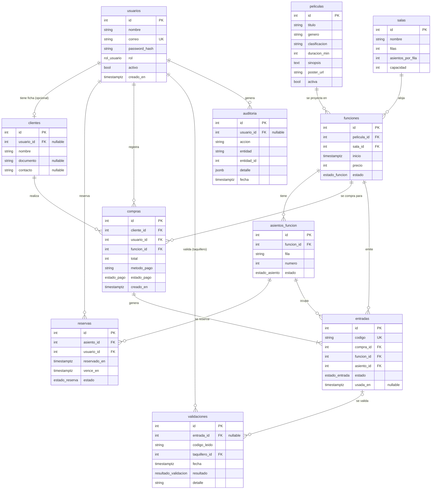

# Modelo de datos

Base de datos PostgreSQL con 11 tablas. El esquema lo crean las migraciones
(`migrations/`) a partir de los modelos de `app/models/` (un archivo por entidad).

Convenciones generales:

- **Fechas**: todas son `timestamptz` y se guardan en **UTC**. La API las devuelve en
  ISO 8601 con la zona de negocio **America/Bogota (UTC-5)**, por ejemplo
  `2026-11-03T22:44:03-05:00`.
- **Dinero**: enteros en pesos colombianos (COP), sin decimales.
- **Estados**: tipos `ENUM` nativos de PostgreSQL (ver [Enumeraciones](#enumeraciones)).
- **Nombres**: del dominio en español, en `snake_case`.

## Diagrama entidad-relación

## Tablas

### `usuarios`
Cuentas con acceso al sistema. El rol (`cliente`, `taquillero`, `administrador`) define los
permisos. La contraseña se guarda **solo** como hash bcrypt (`password_hash`), que nunca
sale en ninguna respuesta de la API. Un usuario desactivado (`activo = false`) no puede
iniciar sesión, pero conserva su historial.
Índice único en `correo` (que siempre se guarda en minúsculas y sin espacios).

### `clientes`
Persona que compra. `usuario_id` es **nullable**: un cliente atendido en taquilla existe sin
cuenta. Al registrarse un cliente por la API se crea el usuario y esta ficha, vinculados. Si se
elimina el usuario, la ficha se conserva (`ON DELETE SET NULL`).

### `peliculas`
Catálogo. `activa = false` equivale a "desactivada": no sale en la cartelera, no admite
funciones nuevas y sus funciones no se listan públicamente. Nunca se borran por la API.
`duracion_min` (1 a 600) define la hora de fin de cada función. `clasificacion` es texto legible y la API solo
acepta `Todo público`, `Mayores de 7`, `Mayores de 12`, `Mayores de 15` o `Mayores de 18` (la columna sigue siendo
`varchar(20)`; la validación está en la API, no en la base). `poster_url` es la ruta del póster en el frontend
(`/posters/<archivo>`).

### `salas`
Distribución física: `filas` (1 a 26, letras A-Z) × `asientos_por_fila` (1 a 30).
`capacidad = filas × asientos_por_fila`, calculada al crear o editar.

### `funciones`
Proyección de una película en una sala. `inicio` en UTC; `precio` entero COP.
`estado` guardado: `activa` o `cancelada`. El estado **efectivo** `finalizada` se calcula al
consultar (una función activa cuya hora de fin ya pasó); no hay un job que lo persista.
`fin = inicio + duracion_min` de la película. No puede solaparse con otra función activa de la
misma sala (duración + 15 minutos de margen).

### `asientos_funcion`
Un registro por asiento físico **de cada función** (se generan todos, en `disponible`, al crear
la función, en la misma transacción). Restricción `UNIQUE (funcion_id, fila, numero)` como
segunda defensa contra duplicados. Se borran en cascada con su función
(`ON DELETE CASCADE`). Un asiento tiene un único estado a la vez (RN-01).

### `reservas`
Bloqueo temporal de un asiento por un usuario. `vence_en = reservado_en +
RESERVA_DURACION_MINUTOS` (5 por defecto). Estados: `activa`, `expirada` (venció),
`convertida` (se vendió) y `cancelada`. El scheduler marca como `expirada` las vencidas cada
30 s y la API también lo aplica "perezosamente" al leer y al escribir.

### `compras`
Operación de venta. `usuario_id` es quien la registró (el cliente desde su cuenta o el
taquillero en ventanilla); `cliente_id` es a quién pertenece. `estado_pago` `aprobado` o
`rechazado` (pago simulado). Una compra rechazada se guarda pero **no** genera entradas.
`total` = precio de la función × cantidad de asientos, congelado al momento de la venta
(los reportes de ingresos usan siempre este valor, no el precio actual).

### `entradas`
Una por asiento vendido. `codigo` único (índice `UNIQUE`), formato `SIV-` + 12 caracteres sin
ambiguos (sin 0, O, 1, I, L). Estados: `activa`, `usada` (se validó en puerta; `usada_en`
guarda cuándo) y `anulada` (la función se canceló).

### `validaciones`
Registro de **cada intento** de validar una entrada en la puerta, válido o no.
`entrada_id` es nullable porque un código inexistente no corresponde a ninguna entrada.
`codigo_leido` guarda lo que se leyó (normalizado).

### `auditoria`
Traza de acciones sensibles: registro, login (exitoso y fallido), gestión de usuarios, CRUD
administrativo, reservas, compras, validaciones y cancelaciones. `detalle` es `JSONB` con
datos de la acción. **Nunca** contiene contraseñas (hay una prueba automática que lo verifica).

## Enumeraciones

| Tipo | Valores |
|---|---|
| `rol_usuario` | `cliente`, `taquillero`, `administrador` |
| `estado_funcion` | `activa`, `cancelada`, `finalizada` |
| `estado_asiento` | `disponible`, `reservado`, `vendido` |
| `estado_reserva` | `activa`, `expirada`, `convertida`, `cancelada` |
| `estado_pago` | `aprobado`, `rechazado` |
| `estado_entrada` | `activa`, `usada`, `anulada` |
| `resultado_validacion` | `valida`, `ya_usada`, `invalida`, `otra_funcion`, `anulada` |

`finalizada` existe en el tipo pero la API la calcula al vuelo (ver `funciones`).

## Índices y restricciones

| Tabla | Único | Índices de búsqueda |
|---|---|---|
| `usuarios` | `correo` | — |
| `clientes` | — | `usuario_id` |
| `funciones` | — | `pelicula_id`, `sala_id`, `inicio`, `estado` |
| `asientos_funcion` | `(funcion_id, fila, numero)` | `funcion_id`, `estado` |
| `reservas` | — | `asiento_id`, `usuario_id`, `vence_en`, `estado` |
| `compras` | — | `cliente_id`, `usuario_id`, `funcion_id`, `estado_pago` |
| `entradas` | `codigo` | `compra_id`, `funcion_id`, `asiento_id`, `estado` |
| `validaciones` | — | `entrada_id`, `codigo_leido`, `taquillero_id`, `resultado` |
| `auditoria` | — | `usuario_id`, `accion`, `fecha` |

En una prueba de volumen (58 mil compras, 110 mil entradas, 60 mil validaciones) los reportes
agregados respondieron en menos de 300 ms con estos índices (las exportaciones CSV sin filtro
de fechas tardaron entre 1 y 2 s). Añadir índices por fecha no cambió los tiempos, por eso no
existen.

## Reglas de integridad que impone la base de datos

- `UNIQUE (funcion_id, fila, numero)` y `UNIQUE (codigo)` impiden asientos y entradas duplicados
  aunque falle la lógica de la aplicación.
- Las claves foráneas impiden compras, entradas o reservas huérfanas.
- La concurrencia (RN-01, RN-02, CA-10) se resuelve con `SELECT ... FOR UPDATE` sobre las filas de
  `asientos_funcion` (ordenadas por `id` para evitar bloqueos cruzados) y sobre `entradas` y
  `funciones` en validación y cancelación. No se usan bloqueos en memoria de Python.
